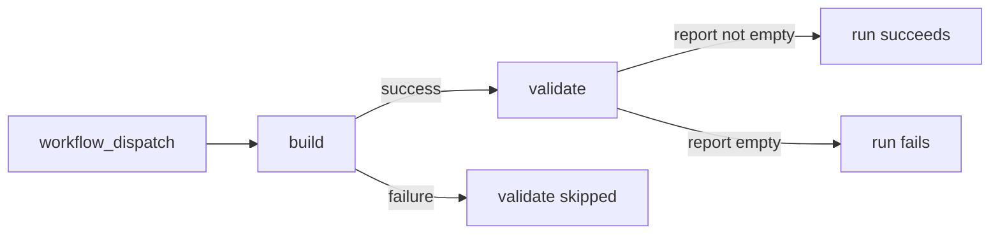

# Activity Report Workflow — Design (As-Is)

Source: [activity-report.yml](../../.github/workflows/activity-report.yml), [build-report.sh](../../scripts/build-report.sh)
Basis: source as of this commit. `build-report.sh` was run locally against test CSV files; the workflow was not run on GitHub.

## Summary

A manually triggered GitHub Actions workflow builds a list of active record IDs from `data/records.csv`, publishes it as the artifact `activity-report`, and checks in a second job that the report is not empty.

**An empty report is not caught where it is made.** If no row is `active`, the `build` job succeeds and uploads a zero-byte file; only the `validate` job fails.

## Context

- Platform: GitHub Actions. Two jobs, `build` and `validate`, both on `ubuntu-latest`.
- Trigger: `workflow_dispatch` only, with no inputs.
- `build` checks out the repository and runs `bash scripts/build-report.sh data/records.csv` from the repository root.
- Actions used: `actions/checkout@v4`, `actions/upload-artifact@v4`, `actions/download-artifact@v4`. Their behavior here comes from their documentation.
- Out of scope: whatever consumes the artifact after the run.

## Interfaces

| Name | Kind | Required / default | Meaning | Consumer |
| --- | --- | --- | --- | --- |
| `$1` | script argument | required | input CSV path; the workflow passes `data/records.csv` | `build-report.sh` |
| `REPORT_DIR` | env var | required | output directory; the workflow sets `${{ runner.temp }}/report` | `build-report.sh` |
| input CSV | file | — | header row, then `id,status`; split on `,`, quotes not handled | `awk` |
| `report.txt` | file | — | one ID per line; overwritten each run; may be empty | upload step |
| exit `1` | exit code | — | `$1` or `REPORT_DIR` missing | `Build report` step fails |
| exit `2` | exit code | — | input file not readable | `Build report` step fails |
| `activity-report` | artifact | — | contains `report.txt` | `validate` |
| `contents: read` | token permission | — | set on `build`; `validate` has none, so it gets the repository default | — |

## Behavior

Job-level outcomes. `validate` runs only when `build` succeeds (`needs: build`, no `if`).

| ID | Condition | Behavior | Source |
| --- | --- | --- | --- |
| B1 | `$1` or `REPORT_DIR` unset or empty | prints the parameter error, exits 1; nothing is created | [L4-L5](../../scripts/build-report.sh#L4-L5) |
| B2 | input file not readable | prints `Cannot read input: <path>` to stderr, exits 2; nothing is created | [L7-L10](../../scripts/build-report.sh#L7-L10) |
| B3 | input readable | writes the first field of each row after the header whose second field is exactly `active` | [L12-L13](../../scripts/build-report.sh#L12-L13) |
| B4 | no row is `active` | `report.txt` is empty, the script exits 0, and `build` uploads it | [L13](../../scripts/build-report.sh#L13), [workflow L17-L22](../../.github/workflows/activity-report.yml#L17-L22) |
| B5 | `report.txt` missing at upload | the upload step fails (`if-no-files-found: error`) | [workflow L22](../../.github/workflows/activity-report.yml#L22) |
| B6 | `validate` runs | downloads the artifact; `test -s report.txt` fails the job if the file is empty | [workflow L24-L33](../../.github/workflows/activity-report.yml#L24-L33) |

### Failure effects

Any failure in the script fails the `Build report` step, so the upload is skipped and so is `validate`. A partial `report.txt` can only remain under `runner.temp`, which is discarded with the hosted runner. Nothing outside the run changes, so a re-run is safe.

## Decisions

No reasons are recorded in the repository. One consequence of the structure: `validate` checks the artifact as downloaded, not the file `build` wrote.

## Verification

| Check | Covers | Expected | Status |
| --- | --- | --- | --- |
| Run the script on `data/records.csv` | B3 | exit 0; `report.txt` is `A100`, `A102` | Passed (local) |
| Run it on a CSV with no `active` row | B4 | exit 0; `report.txt` is empty | Passed (local) |
| Run it with a path that does not exist | B2 | exit 2; stderr message; no output directory | Passed (local) |
| Run it without `REPORT_DIR`, then without `$1` | B1 | exit 1 both times; no output directory | Passed (local) |
| Dispatch the workflow with no `active` row | B4, B6 | `build` succeeds; `validate` fails | Planned |

## Open Questions

- Is an empty report a valid result? Today `build` treats it as valid and `validate` as an error.
- The CSV is split on every `,` and quotes are not handled. Is that the agreed input format?
