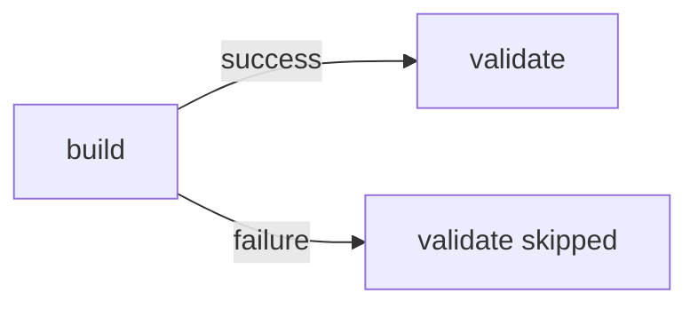

# Diagrams

Draw a diagram only when it shows a relationship faster than a table or a paragraph. Many good documents have none.

## Choose by the reader's question

| Question | Use |
| --- | --- |
| What depends on what? Which branch leads where? | `flowchart` |
| Who sends what to whom, in what order? | `sequenceDiagram` |
| Which states does a persistent item go through? | `stateDiagram-v2` |
| How do data entities relate? | `erDiagram`, or link the schema |
| How do types compose or inherit? | `classDiagram` |
| What are the inputs and outputs? | a table |
| Why was this chosen? | prose |

## Rules

- One level of abstraction per diagram. A job graph does not show shell commands.
- Draw only edges and states that exist in the source (As-Is) or follow from a decision (To-Be). Do not invent an order between independent jobs.
- Show the failure paths that matter. A success-only picture of a branching flow misleads.
- Use the same names as the tables.
- One sentence under the diagram saying what it shows.
- `flowchart LR` usually reads better for pipelines and dependencies, `TD` for branch-heavy control flow.
- Use common Mermaid syntax; GitHub's renderer lags the latest Mermaid release. Preview it if you can.

## Example

